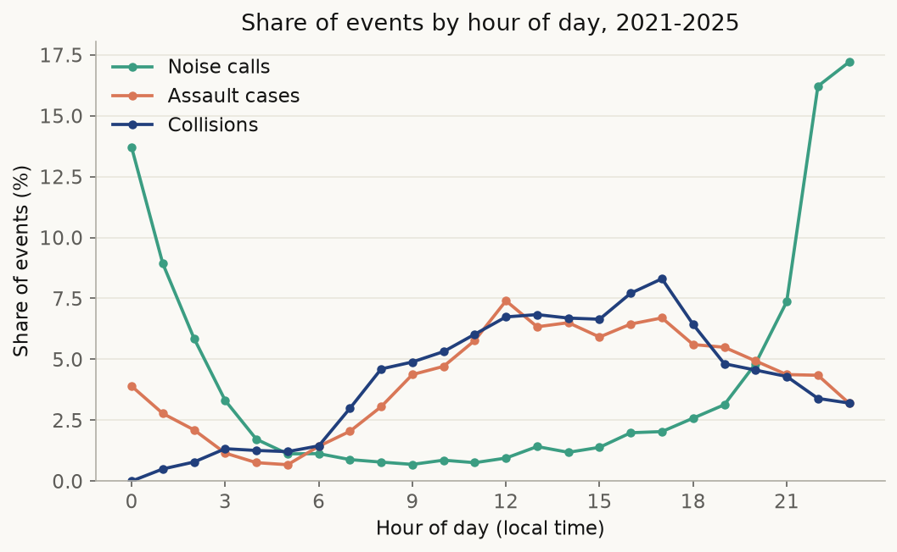

# The rhythm of a college town

[](https://github.com/UCB-stat159-f26/final-project-team-16/actions/workflows/tests.yml)
[](https://mybinder.org/v2/gh/UCB-stat159-f26/final-project-team-16/HEAD?labpath=main.ipynb)

When and where do problems arise in Berkeley, and does police enforcement follow them?

This repository holds the data, code, analysis notebooks, and report for Team 16's STAT 159 final project at UC Berkeley, Fall 2026. We use four open datasets from the [Berkeley Police Department (BPD) Transparency Hub](https://bpd-transparency-initiative-berkeleypd.hub.arcgis.com/search): calls for service, crime cases, traffic collisions, and vehicle stops. We describe when and where noise complaints, assaults, collisions, and reckless-driving complaints are recorded and compare them with vehicle stops.

- **Website:** <https://ucb-stat159-f26.github.io/final-project-team-16/> has the main report and every analysis notebook.
- **Main report:** [`main.ipynb`](main.ipynb) summarizes and discusses the results.
- **Run it online:** the Binder badge above opens `main.ipynb` in JupyterLab with nothing to install. Binder builds the `bpd-rhythm` environment from `environment.yml`, and the first start can take several minutes.

## Motivation

Berkeley is a city built around a large university. Daily life follows the hour of the day, the day of the week, and the academic calendar. Parties, football games, move-in, and finals change who is in town and what they do. BPD publishes its records as open data, so anyone can check if these rhythms appear. Calls for service, crime cases, and collisions describe demand: what residents report and police record. Vehicle stops describe a response officers start themselves. Comparing their timing and place shows how far enforcement lines up with reported problems. The results are descriptive summaries of recorded events. We make no claim about the effect of enforcement.

## Research questions and analysis

Our analysis is organized into four sections: context, time, academic calendar, and location. Each section answers a group of related questions, and each question has an ID used across the notebooks and the report.

| Section | Question | Notebook | Datasets |
|---|---|---|---|
| Context | A1. How have traffic stops and collisions changed over time, and do they move together? | [`02_trends.ipynb`](notebooks/02_trends.ipynb) | Stops, collisions |
| Time | A2. At what times of day and days of the week do noise complaints, assaults, and collisions peak? | [`03_clock.ipynb`](notebooks/03_clock.ipynb) | Calls, crime cases, collisions |
| Time | A6. How do the timing patterns of calls for service and police stops differ across types of calls and stops? | [`03_clock.ipynb`](notebooks/03_clock.ipynb) | Calls, stops |
| Time | A7. Do traffic stops happen at the same times as collisions, and does this differ between weekdays and weekends? | [`03_clock.ipynb`](notebooks/03_clock.ipynb) | Stops, collisions |
| Academic calendar | A3. Do noise complaints and assaults near campus follow the academic calendar (semester vs. breaks) more than in the rest of Berkeley? | [`04_calendar.ipynb`](notebooks/04_calendar.ipynb) | Calls, crime cases |
| Academic calendar | A4. Do noise complaints, assaults, and alcohol-related collisions increase during events like home football games, move-in week, Halloween, and finals? | [`04_calendar.ipynb`](notebooks/04_calendar.ipynb) | Calls, crime cases, collisions |
| Location | A5. Do areas with more reckless-driving complaints also have more collisions and more traffic stops? | [`06_driving_places.ipynb`](notebooks/06_driving_places.ipynb) | Calls, collisions, stops |
| Location | A8. Are noise complaints concentrated in a few blocks, and do the same blocks stay hotspots over time? | [`05_noise_hotspots.ipynb`](notebooks/05_noise_hotspots.ipynb) | Calls |

Every notebook works with counts of recorded events. `01_data_overview.ipynb` checks table contents and time reliability first. The trends notebook correlates monthly stops and collisions (Pearson and Spearman). The clock notebook builds 24-hour share profiles, measures overlap from 0 to 1, and runs a fixed-seed permutation test with 9,999 shuffles. The calendar notebook compares Fall 2024 semester and winter break daily rates by area, plus event days with matched ordinary days. The location notebooks rank the 14 police beats with Spearman correlation and measure the share of noise calls in the busiest blocks. Each notebook saves its result tables, four of them also save figures, and `main.ipynb` reports them.

### Key findings

- From 2021 to 2025, 56% of the 12,693 noise calls came between 22:00 and 01:59, peaking at 23:00, while collisions peaked at 17:00.
- In Southside, the beats south of campus, noise calls averaged 3.73 per day during the Fall 2024 semester and 0.71 during winter break. The semester rate was 5.27 times the break rate there and 1.88 times in the other beats.
- Vehicle stops shared more timing with collisions on weekdays (overlap 0.81) than on weekends (overlap 0.72), and monthly totals in 2024 to 2025 did not move together (Pearson r = -0.03 over 24 months).
- Across the 14 police beats in 2024 to 2025, beats with more reckless-driving calls also had more collisions (Spearman ρ = 0.753), while the link between those calls and vehicle stops was weak (0.191).
- Noise calls were concentrated in a few blocks, with the busiest 5% of blocks (81 of 1,626) holding 44.3% of all calls and seven blocks ranking in the top 20 in all five years.

The full results, checks, and limits are in the main report at [`main.ipynb`](main.ipynb).



## Data

All four datasets come from the BPD Transparency Hub. We store a snapshot of each dataset in this repository, so the analysis runs offline and produces the same numbers on every run.

| Dataset | Source | Downloaded | Files in the repository | Records |
|---|---|---|---|---:|
| Calls for Service | [Calls for Service, 2019 - Current](https://www.arcgis.com/sharing/rest/content/items/272dfb0d5c5144679368fb2f97422a35/data) | 2026-11-23 | `data/processed/calls_2021_2025.csv.gz` | 307,628 calls |
| Crime Data | [Crime cases with map points (`cases_latlon`)](https://services7.arcgis.com/vIHhVXjE1ToSg0Fz/arcgis/rest/services/cases_latlon/FeatureServer/0) | 2026-11-23 | `data/processed/crime_cases_2021_2025.csv.gz` | 51,418 cases |
| Collision Data | [Collision Data](https://bpd-transparency-initiative-berkeleypd.hub.arcgis.com/datasets/fcb1720b81844fed9d2212ffe2f35c74/explore) | 2026-11-22 | `data/raw/collision_data.csv`, `data/processed/collisions.csv` | 16,639 collisions |
| Stop Data | [Stop Data](https://bpd-transparency-initiative-berkeleypd.hub.arcgis.com/datasets/078f7d987228453ca30cf7a99311d8de/about) | 2026-11-22 | `data/raw/stop_data.csv`, `data/processed/vehicle_stops.csv` | 7,431 vehicle stops |

- **Analysis window:** Calls for service and crime cases cover 2021-01-01 to 2025-12-31. Vehicle stops start in January 2024, so every comparison with stops uses 2024 to 2025.
- **Raw files:** The raw Calls for Service file (about 58 MB) and the raw crime file (about 30 MB) change every day at the source, so we store the 2021 to 2025 tables built from them as compressed CSV files. Running `make data` downloads fresh raw files into `data/downloads/` and rebuilds the tables, so the rebuilt tables can differ from the stored snapshot.
- **Additional sources:** Police beat polygons from the City of Berkeley live in `data/boundaries/`. Fall 2024 semester, break, and event dates live in `data/calendar/`, each with a link to its source.
- **Documentation:** [`data/README.md`](data/README.md) lists the sources, snapshot dates, checksums, and counting rules for stops and collisions. The codebooks in [`data/codebooks/`](data/codebooks) explain each column of the calls, crime cases, collisions, vehicle stops, calendar, and address lookup tables.
- **Counting rules:** Raw stops can list multiple people and raw crime cases can list multiple statutes, so our prepared tables keep one row per stop and per case. All times are local time in the `America/Los_Angeles` time zone.

## Repository structure

```text
final-project-team-16/
├── README.md                 # this file
├── main.ipynb                # main report: shows saved figures and tables, no computation
├── contributions.ipynb       # what each member did, and personal reflections
├── index.md                  # home page of the website
├── notebooks/                # analysis notebooks, run in name order
│   ├── 01_data_overview.ipynb     # what the four tables hold and their limits
│   ├── 02_trends.ipynb            # A1: stops and collisions by month
│   ├── 03_clock.ipynb             # A2, A6, A7: hour of day and day of week
│   ├── 04_calendar.ipynb          # A3, A4: semester, break, and event days
│   ├── 05_noise_hotspots.ipynb    # A8: noise calls by block
│   └── 06_driving_places.ipynb    # A5: driving calls, collisions, and stops by beat
├── bpdtools/                 # the project's Python package, imported by the notebooks
├── tests/                    # pytest unit tests, one file per bpdtools module
├── scripts/                  # scripts that download the data and build the tables
├── data/
│   ├── README.md             # sources, snapshot dates, and counting rules
│   ├── raw/                  # stop and collision files as downloaded
│   ├── processed/            # tables that the notebooks read and write
│   ├── calendar/             # Fall 2024 semester, break, and event dates
│   ├── mappings/             # classification of collision factors
│   ├── boundaries/           # police beat polygons
│   └── codebooks/            # what each column means
├── figures/                  # figures that the notebooks save
├── results/                  # result tables that the notebooks save
├── assets/                   # logo, icon, and style of the website
├── environment.yml           # conda environment bpd-rhythm
├── Makefile                  # env, all, test, lint, data, and html targets
├── pyproject.toml            # settings of the package, pytest, and ruff
├── myst.yml                  # settings and table of contents of the website
├── .github/                  # test and deploy workflows, pull request template
├── CONTRIBUTING.md           # how the team works with issues, branches, and reviews
├── LICENSE                   # licenses for code, text and figures, and data
├── instructions.md           # project instructions from the course
├── .gitignore                # files that git does not track
├── .gitattributes            # line ending rules, so data files keep their bytes
└── .editorconfig             # editor settings for indentation and line endings
```

## Getting started

You need conda (for example from [Miniforge](https://github.com/conda-forge/miniforge)), `make`, and `git`. On Windows, use WSL and install Miniforge inside it, because `make` is not part of Windows. If `make` is missing in WSL, install it with `sudo apt install make`.

If a new terminal cannot find `conda`, run `conda init` once with the full path and the name of your shell, then open a new terminal. For example, run `~/miniforge3/bin/conda init zsh` on macOS, or `~/miniforge3/bin/conda init bash` on Linux and WSL.

```bash
git clone https://github.com/UCB-stat159-f26/final-project-team-16.git
cd final-project-team-16
make env
conda activate bpd-rhythm
```

`make env` creates the conda environment `bpd-rhythm` from `environment.yml`. If the environment already exists, the same command updates it to match the file. The environment also installs the project's own package, `bpdtools`, from this folder.

## Running the analysis

```bash
make all
```

`make all` runs every notebook in `notebooks/` in name order, followed by `main.ipynb` and `contributions.ipynb`, inside the `bpd-rhythm` environment. The whole run takes about half a minute. Each notebook runs in place with the `python3` kernel and rewrites the figures and tables that it saves. The command reads only files in the repository and does not download data. Run times are not saved in the notebooks, so a second run produces the same files.

The `Makefile` has one target for each task. Run `make help` to list them.

| Command | What it does |
|---|---|
| `make env` | Create the `bpd-rhythm` environment, or update it when it exists |
| `make all` | Run every notebook in `notebooks/`, then `main.ipynb` and `contributions.ipynb` |
| `make test` | Run the unit tests in `tests/` |
| `make lint` | Check code style, names, and docstrings with ruff |
| `make data` | Download the raw Calls for Service and crime files and rebuild their tables (needs the internet) |
| `make html` | Build the website into `_build/html` |
| `make help` | List the targets |

## Testing

```bash
make test
```

`make test` runs `python -m pytest` inside the `bpd-rhythm` environment. pytest reads its settings from `pyproject.toml`, runs the tests in `tests/`, and treats every warning as an error. Each `bpdtools` module with functions has a matching test file in `tests/`. Most tests build a small table and check the real function on it, and the whole run finishes in about a second.

```bash
make lint
```

`make lint` runs `ruff check .` and then `ruff format --check .` inside the `bpd-rhythm` environment. The first command checks code style, import order, names, and docstrings in the NumPy style. The second command lists the files that `ruff format` would change. Both commands read their settings from `pyproject.toml` and also check the notebooks. To format a file, run `ruff format <file>` in the activated environment.

## Automation

Two GitHub Actions workflows in `.github/workflows/` run automatically. On every pull request and every push to `main`, `tests.yml` runs ruff checks and unit tests, and the badge at the top of this README shows its latest result. On every push to `main`, `deploy.yml` builds the website and publishes it to GitHub Pages. Locally, `make all` reruns the whole analysis in one command.

## The `bpdtools` package

Reusable steps live in the `bpdtools` package as functions with NumPy-style docstrings, which the notebooks and scripts import. Running `make env` installs the package, letting `import bpdtools` work from any folder.

| Module | Functions | Purpose |
|---|---|---|
| `load.py` | `load_calls`, `load_cases`, `classify_call_type`, `read_text_table` | Read the calls and crime case tables with local times |
| `traffic.py` | `load_stops`, `load_collisions` | Read the vehicle stop and collision tables |
| `timeparts.py` | `add_time_parts` | Add the local hour, weekday, month, and a weekend flag |
| `clock.py` | `timed_hours`, `hour_weekday_table`, `hourly_profile`, `profile_overlap`, `overlap_permutation_test` | Count events by hour and weekday and compare two hour profiles |
| `trends.py` | `monthly_counts` | Count events in each calendar month |
| `calendar_rates.py` | `period_rates` | Compare semester and winter-break event rates |
| `hotspots.py` | `block_counts`, `top_share`, `yearly_top_overlap` | Count calls per block and measure how concentrated they are |
| `sectors.py` | `normalize_block_address`, `assign_sectors`, `attach_address_sectors`, and five more | Place addresses, calls, and crime cases in police beats |
| `plots.py` | `set_plot_style`, `plot_hour_weekday_heatmap`, `plot_hourly_profiles` | Shared figure style and the hour and weekday plots |
| `paths.py` | `repo_path` | Build file paths from the repository root |
| `config.py` | constants only | Random seed, time zone, analysis window, and call type groups |
| `calls.py`, `crime.py`, `download.py`, `files.py` | 16 functions | Helpers for the scripts that download and clean the data |

```python
from bpdtools.clock import hourly_profile
from bpdtools.load import load_calls

# Share of calls in each hour of the day, one column per call group
calls = load_calls()
profile = hourly_profile(calls, time_column="local_time", group_column="call_group")
```

## Website

The project website is at <https://ucb-stat159-f26.github.io/final-project-team-16/>. Built with MyST from `myst.yml`, it displays the home page, main report, analysis notebooks, data documentation, and contributions notebook. Run `make html` to build the pages locally into `_build/html`, or run `myst start` in the activated environment for a live preview.

## Reproducibility notes

- **Random seed:** The permutation test is the only random step, and it uses `SEED = 159` from `bpdtools/config.py`.
- **Environment:** `environment.yml` pins Python 3.12 and a MAJOR.MINOR version for every package except `tzdata` and `pip`, using only the conda-forge channel.
- **Data:** `make all` reads the snapshots stored in the repository and never downloads data.
- **Kernel:** Every notebook uses the `python3` kernel, matching what `make all` and Binder use.
- **Paths:** No file holds an absolute path, so the code runs on any computer when you start `make` and the scripts from the repository root.

## Team, contributions, and reflections

- Minchee Yang
- John Hu
- Winny Wen

[`contributions.ipynb`](contributions.ipynb) describes what each member did and holds each member's personal reflections. [`CONTRIBUTING.md`](CONTRIBUTING.md) outlines how we work with issues, branches, and reviews.

## License

| Material | License |
|---|---|
| Code, including scripts and notebook code cells | MIT |
| Report text, notebook prose, and figures | CC BY 4.0 |
| The team's own data contributions (calendar flags, event windows, classification mappings, derived columns) | CC0 1.0 |
| Berkeley Police Department records and other third-party material | The terms of each provider |

The full terms are in [`LICENSE`](LICENSE). We license code, text and media, and data separately so each type of material can be reused with credit.
